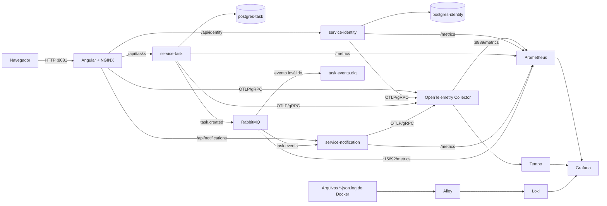

# Task Manager System

## Design

Protótipo de interface no Figma: [Task Manager — Product UI — Angular](https://www.figma.com/design/30NGvSADIVJnbFmHP3rhx0/Task-Manager-%E2%80%94-Product-UI---Angular?node-id=7-2&m=dev)

Plataforma de gerenciamento de tarefas com três microsserviços Go, SPA Angular, PostgreSQL isolado por domínio,
RabbitMQ e uma stack local de observabilidade. Consulte [`docs/ARCHITECTURE.md`](docs/ARCHITECTURE.md) e os
[ADRs](docs/adrs/). Termos de negócio estão no [`GLOSSARY.md`](GLOSSARY.md).

## Documentação por módulo

| Módulo                 | README                                                             | Conteúdo                                                                    |
|------------------------|--------------------------------------------------------------------|-----------------------------------------------------------------------------|
| `shared`               | [`shared/README.md`](shared/README.md)                             | Pacotes comuns, contratos de auth, correlação, broker, métricas e tracing.  |
| `service-identity`     | [`service-identity/README.md`](service-identity/README.md)         | Registro/login, perfil (nome e senha), bcrypt, emissão de JWT e rate limit. |
| `service-task`         | [`service-task/README.md`](service-task/README.md)                 | CRUD autenticado, outbox transacional e dispatch AMQP.                      |
| `service-notification` | [`service-notification/README.md`](service-notification/README.md) | Consumo de `task.created`, Ack/Nack e DLQ.                                  |
| `frontend`             | [`frontend/README.md`](frontend/README.md)                         | Rotas, guards, interceptors, sessão, proxy e build NGINX.                   |
| `provisioning`         | [`provisioning/README.md`](provisioning/README.md)                 | Prometheus, Tempo, OTel Collector, Grafana e RabbitMQ.                      |

## Arquitetura



O NGINX é a única entrada das APIs em `0.0.0.0:8081`. Grafana e RabbitMQ Management são portas administrativas
vinculadas a `127.0.0.1`. APIs, bancos, AMQP, OTLP, Tempo e Prometheus não publicam portas no host.

## Setup

1. Crie o arquivo local de segredos:

   ```sh
   cp .env.example .env
   ```

2. Substitua todos os valores de exemplo. Use senhas aleatórias e distintas. Como as senhas dos bancos e do RabbitMQ
   são inseridas em URLs, use caracteres alfanuméricos ou aplique percent-encoding.

3. Valide e suba a stack:

   ```sh
   docker compose config -q
   docker compose up --build -d
   docker compose ps
   ```

O Compose falha imediatamente se uma variável obrigatória estiver ausente. O usuário RabbitMQ vem de `.env`; o usuário
`guest` não é utilizado pelos containers da aplicação.

| Componente           | URL local                               | Exposição           |
|----------------------|-----------------------------------------|---------------------|
| Frontend             | http://localhost:8081                   | todas as interfaces |
| service-identity     | http://localhost:8081/api/identity      | via NGINX           |
| service-task         | http://localhost:8081/api/tasks         | via NGINX           |
| service-notification | http://localhost:8081/api/notifications | via NGINX           |
| Grafana              | http://localhost:3000                   | somente loopback    |
| RabbitMQ Management  | http://localhost:15672                  | somente loopback    |

Grafana recebe as credenciais de `.env`. Os datasources Prometheus e Tempo e os dashboards são provisionados
automaticamente. Não é necessário importar dashboards manualmente.

```sh
docker compose logs -f service-notification
docker compose down       # preserva volumes nomeados
docker compose down -v    # remove dados locais persistidos
```

## Escalabilidade horizontal e balanceamento

O NGINX é o único ponto de entrada HTTP. Os upstreams `identity_backend`, `task_backend` e `notification_backend` usam
`least_conn`, `resolver 127.0.0.11 valid=10s` e `server service-<nome>:8080 resolve`. O DNS interno do Compose devolve
todos os IPs das réplicas e o NGINX redistribui sem alteração de configuração. Nenhuma API publica porta no host, então
os serviços podem ser escalados sem conflito de portas.

```sh
# suba a stack uma vez; as migrations são idempotentes, mas a primeira subida inicializa o schema
docker compose up -d
# depois escale 3 réplicas de service-task e 2 de service-notification
docker compose up -d --scale service-task=3 --scale service-notification=2

# confira as réplicas e os healthchecks
docker compose ps
docker compose logs --tail=20 service-task
```

Para validar a distribuição, repita chamadas ao healthcheck e confira o `upstream_addr` no log JSON do NGINX:

```sh
for i in $(seq 1 6); do
  curl -s -o /dev/null -w '%{http_code}\n' http://localhost:8081/api/identity/health
done
docker compose logs --tail=20 frontend | grep '/api/identity/health'
```

O campo `upstream_addr` muda entre as réplicas e `trace_id`/`correlation_id` continuam correlacionando NGINX, serviço,
outbox e consumidor. Para voltar ao número original:

```sh
docker compose up -d --scale service-task=1 --scale service-notification=1
```

Limites e cuidados ao escalar:

- **Rate limit do Identity**: o limiter é em memória e por processo; com `N` réplicas o limite efetivo de
  `/register`, `/login` e `/me/password` passa a ser aproximadamente `10 × N` por minuto por IP. Para um limite global,
  aplique rate limit no NGINX ou em um armazenamento compartilhado.
- **service-task**: cada réplica executa a API e o dispatcher do outbox. O `FOR UPDATE SKIP LOCKED` evita que duas
  réplicas confirmem o mesmo evento, mas todas continuam publicando no RabbitMQ e disputando o outbox.
- **service-notification**: todas as réplicas consomem a mesma fila durável `task.events`; cada mensagem é entregue a
  uma réplica. A entrega continua at-least-once, então o consumidor deve deduplicar por `MessageId`/`event_id`.
- **Métricas**: o scrape do Prometheus é estático por nome de serviço e não descobre todas as réplicas. Para medir cada
  réplica, use service discovery ou alvos explícitos. Logs e traces continuam cobrindo todas as réplicas via Alloy e
  OTLP.
- **Infraestrutura**: não escale `postgres-identity`, `postgres-task`, `rabbitmq`, `loki`, `tempo` ou `prometheus` com
  `--scale`; eles exigem configuração de HA própria. O NGINX pode manter conexões com uma réplica recém-removida por
  até `valid=10s`, até o próximo refresh de DNS.

## API

### Identity

| Método | Rota           | Descrição                                                         | Sucesso        |
|--------|----------------|-------------------------------------------------------------------|----------------|
| POST   | `/register`    | Cria usuário e devolve JWT                                        | `201`          |
| POST   | `/login`       | Autentica e devolve JWT                                           | `200`          |
| GET    | `/me`          | Perfil do usuário autenticado (`{id,email,name}`)                 | `200`          |
| PATCH  | `/me`          | Altera o nome (`{"name":"..."}`, 1–100 caracteres)                | `200`          |
| PUT    | `/me/password` | Troca a senha (`{"current_password":"...","new_password":"..."}`) | `204`          |
| GET    | `/health`      | Verifica serviço e PostgreSQL                                     | `200` ou `503` |
| GET    | `/metrics`     | Métricas Prometheus do serviço                                    | `200`          |

Cadastro/login: `{"email":"user@example.com","password":"secret123"}`.

Respostas de `/register` e `/login` incluem `name` (vazio até o usuário defini-lo no perfil). As rotas `/me` exigem
`Authorization: Bearer <jwt>`; a senha atual incorreta em `PUT /me/password` devolve `403`.

`POST /register`, `POST /login` e `PUT /me/password` aceitam 10 requisições por minuto por IP; excedentes recebem `429`
com `Retry-After: 60`.

### Tasks

Rotas de tarefas exigem `Authorization: Bearer <jwt>`.

| Método | Rota | Descrição | Sucesso |
|---|---|---|---|
| GET | `/tasks?limit=50&offset=0` | Lista tarefas do usuário com paginação (`limit` 1..100, padrão 50) | `200` |
| POST | `/tasks` | Cria tarefa e devolve `{"id": number}` | `201` |
| GET | `/tasks/{id}` | Busca tarefa | `200` |
| PUT | `/tasks/{id}` | Substitui a tarefa e devolve `{"id": number}` | `200` |
| DELETE | `/tasks/{id}` | Remove tarefa | `204` |
| PATCH | `/tasks/{id}/move` | Move a tarefa no quadro (`status`, `before_id`, `after_id`) | `200` |
| GET | `/tasks/{id}/history?limit=50&offset=0` | Lista alterações, mais recentes primeiro | `200` |
| GET | `/health` | Verifica serviço e dependências | `200` ou `503` |
| GET | `/metrics` | Métricas Prometheus do serviço | `200` |

Corpo de criação e atualização:

```json
{"title":"...","description":"...","status":"todo","priority":"high","due_date":"2026-11-15"}
```

`status` aceita `todo`, `doing` ou `done`. `priority` aceita `low`, `medium`, `high` ou `urgent`. No `POST`, valores
vazios assumem `todo` e `medium`. `due_date` aceita `YYYY-MM-DD` ou `null`. O `PUT` substitui todos esses campos: omitir
`priority` restaura `medium`, e omitir `due_date` remove o prazo. Respostas de consulta incluem `id`, `title`,
`description`, `status`, `priority`, `due_date`, `position`, `created_at` e `updated_at`; não incluem `user_id`.

### Frontend

A SPA Angular consome as APIs por URLs relativas (`/api/identity`, `/api/tasks`, `/api/notifications`). O NGINX cria o
trace de entrada e balanceia as requisições entre os serviços com `least_conn`. Rotas protegidas por `authGuard`:

| Rota | Tela |
|---|---|
| `/login`, `/register` | Autenticação |
| `/dashboard` | Indicadores e tarefas recentes |
| `/tasks` | Lista com busca e filtros |
| `/tasks/board` | Quadro por status |
| `/tasks/new`, `/tasks/:id/edit` | Criação e edição |
| `/tasks/:id` | Detalhe da tarefa |
| `/activities` (`/notifications` redireciona) | Atividades e saúde do consumidor |
| `/profile` | Perfil: editar nome e alterar senha |

`TaskDataService.list()` pagina em blocos de 100 até esgotar os resultados, respeitando o máximo do backend. Criação e
edição consomem somente `{"id": number}`. Após criar, o formulário navega para `/tasks/board`; após editar, navega para
`/tasks/{id}`.

### Notifications

`GET /health` verifica o processo e RabbitMQ; `GET /metrics` expõe métricas Prometheus. O consumidor recebe
`task.created` na fila durável `task.events`.
Evento JSON inválido recebe `Nack` sem requeue e segue para `task.events.dlq` pela exchange `tasks.dlx`. O consumidor não
faz retry próprio; o publisher usa outbox transacional com retry/backoff e entrega at-least-once. Não há entrega de
notificação externa implementada.

### Erros

| Status | Quando                                                                                 |
|--------|----------------------------------------------------------------------------------------|
| `400`  | JSON inválido, campo desconhecido, paginação inválida, `id` inválido, título ausente, status inválido, nome ou nova senha inválidos |
| `401`  | JWT ausente, inválido ou expirado; credenciais incorretas no login                     |
| `403`  | senha atual incorreta em `PUT /me/password`                                            |
| `404`  | tarefa não encontrada ou pertencente a outro usuário; usuário do token inexistente em `/me` |
| `409`  | e-mail já cadastrado em `/register` ou vizinhança desatualizada em `PATCH /tasks/{id}/move` |
| `413`  | corpo acima do limite: 16 KiB em Identity, 1 MiB em Tasks                              |
| `429`  | limite de 10 requisições por minuto por IP em `/register`, `/login` e `/me/password`   |
| `500`  | erro interno não classificado                                                          |
| `503`  | dependência indisponível retornada por `/health`                                       |

## Correlação e telemetria

- `x-correlation-id` é um identificador de aplicação para logs e eventos, não um header W3C Trace Context.
- Os serviços aceitam apenas UUIDs v4 válidos, devolvem o header, armazenam o valor no `context.Context` e registram
  `correlation_id` nos logs JSON. Header ausente ou inválido é substituído por UUID v4.
- O `service-task` copia `x-correlation-id` para o header AMQP e o consumidor o extrai.
- O módulo OpenTelemetry do NGINX cria o trace na borda e injeta W3C Trace Context. `otelhttp`, outbox e headers AMQP
  preservam a árvore até o span `CONSUMER`. Spans são exportados por OTLP/gRPC quando
  `OTEL_EXPORTER_OTLP_ENDPOINT` está definido. Sem o endpoint, a exportação fica desabilitada e a aplicação segue com
  propagação e provider no-op.
- Traces seguem por OTLP/Collector para Tempo. Métricas são coletadas pelo Prometheus nos endpoints internos `/metrics`.
- Logs JSON incluem `service_name`, `correlation_id`, `trace_id` e `span_id` quando disponíveis. O Docker grava
  `stdout` e `stderr` em arquivos `*-json.log`; o Alloy lê esses arquivos, aplica `stage.docker` e envia as linhas ao
  Loki, que mantém retenção de 7 dias. Labels são apenas `service_name`, `level` e `container`.
- No Grafana, um log de `/api/*` abre o trace correspondente e um trace abre os logs via `trace_id`.
- Bodies HTTP são registrados sanitizados: até 64 KiB, somente JSON completo e válido; apenas `status`, `priority`,
  `due_date`, `before_id` e `after_id` mantêm o valor, o restante vira `[REDACTED]`. As respostas de `/api/*` incluem
  `X-Trace-ID`; o NGINX não registra query string, headers de autenticação nem body.
- Além dos logs HTTP, os serviços registram eventos de negócio em `INFO` (`user_registered`, `login_succeeded`,
  `profile_updated`, `password_changed`, `task_created`, `task_updated`, `task_moved`, `task_deleted`,
  `outbox_event_published`, `notification_received`, `consumer_started`/`consumer_stopped`), em `WARN` (`login_failed`,
  `outbox_event_retry_scheduled`) e em `ERROR` (`internal_error`, `invalid event`, `outbox publish failed`). Esses logs
  carregam apenas IDs, status, prioridade e posição; e-mail, nome, título, descrição, senha e token não são registrados.

Consultas úteis no Grafana Explore (datasource Loki):

```logql
{service_name="service-task"} | json | trace_id="<trace-id>"
{service_name="service-notification"} | json | correlation_id="<correlation-id>"
{service_name="frontend-edge"} | json | status >= 500
{service_name=~"service-.*"} | json | request_body_valid_json="false"
```

### Métricas de negócio

| Métrica | Labels | Uso |
|---|---|---|
| `task_manager_identity_auth_attempts_total` | `operation`, `outcome` | cadastros, logins, leitura/edição de perfil e troca de senha por resultado |
| `task_manager_task_operations_total` | `operation`, `outcome` | CRUD de tarefas por resultado |
| `task_manager_task_outbox_events_total` | `outcome` | eventos enviados, retries e falhas do outbox |
| `task_manager_notification_events_total` | `outcome` | eventos confirmados, rejeitados e falhas de Ack/Nack |

Todos os serviços também expõem `task_manager_http_requests_total`,
`task_manager_http_request_duration_seconds`, métricas `go_*` e `process_*`. Labels usam padrões de rota e conjuntos
limitados; IDs de usuário/tarefa/evento, e-mail, correlation ID, URL bruta e texto de erro não são labels.

Exemplos PromQL:

```promql
sum by (operation, outcome) (rate(task_manager_task_operations_total[5m]))
sum by (outcome) (rate(task_manager_task_outbox_events_total[5m]))
histogram_quantile(0.95, sum by (service, le) (rate(task_manager_http_request_duration_seconds_bucket[5m])))
```

### Dashboards Grafana

Os arquivos em `provisioning/grafana/dashboard-definitions/` são provisionados na pasta `Task Manager`:

| Dashboard | Visão |
|---|---|
| `Task Manager - Observabilidade Unificada` | ponto de entrada para métricas, traces recentes, busca por `trace_id` e logs correlacionados |
| `Task Manager - Visão de Negócio` | cadastro, login, CRUD, outbox e consumo de notificações |
| `Task Manager - Backends Go` | disponibilidade, taxa HTTP, 5xx, p95/p99, goroutines e memória |
| `Task Manager - RabbitMQ` | conexões, canais, consumidores, filas/DLQ, vazão, recursos e alarmes |

O plugin oficial `rabbitmq_prometheus` atende internamente em `rabbitmq:15692/metrics`. Métricas por objeto separam
`task.events` e `task.events.dlq`; `:15692` não é publicado no host.

## Persistência e redes

Identity persiste usuários em `users`. Task persiste tarefas em `tasks`, alterações em `task_history` e eventos para
publicação em `task_outbox`. A criação grava tarefa, histórico e outbox na mesma transação. O outbox mantém
`event_id`, payload, `correlation_id`, `trace_context`, tentativas, disponibilidade, criação e envio. `trace_context` é
JSONB e preserva o carrier W3C entre a requisição e o dispatcher. O Notification não possui banco.

PostgreSQL, RabbitMQ, Tempo, Prometheus, Grafana e Loki usam volumes nomeados. Redes internas separam dados de Identity,
dados de Task, mensageria e telemetria. A rede `edge` contém apenas frontend e APIs. Cada serviço acessa somente as
dependências necessárias. Como redes Docker `internal` não publicam portas, o Grafana também participa da rede bridge
`admin`, usada somente para expor `127.0.0.1:3000`.

O armazenamento do JWT no frontend e suas mitigações estão em [frontend/SECURITY.md](frontend/SECURITY.md).

## Desenvolvimento

```sh
cd shared && go test ./...
cd service-identity && go test ./...
cd service-task && go test ./...
cd service-notification && go test ./...

cd frontend
npm install
npm run start
npm run build
npm test -- --no-watch --code-coverage
```

Os três serviços importam o módulo local `shared/` (via `replace`) com correlação, logging, middleware, auth, HTTP e
telemetria comuns. Por isso o context de build é a raiz do repositório; o `.dockerignore` da raiz limita o contexto aos
diretórios `shared/` e `service-*/`.

Contexts Docker ignoram dependências, builds, cobertura e arquivos `.env`. Arquivos `.env.*` são ignorados pelo Git,
exceto exemplos e certificados versionados explicitamente.

## Validação de infraestrutura

Com `.env` configurado:

```sh
docker compose config -q
docker run --rm -v "$PWD/provisioning/tempo/tempo.yaml:/etc/tempo.yaml:ro" \
  grafana/tempo:3.1.1 -config.file=/etc/tempo.yaml -config.verify=true
docker run --rm -v "$PWD/provisioning/otel-collector/config.yaml:/etc/otelcol-contrib/config.yaml:ro" \
  otel/opentelemetry-collector-contrib:0.164.0 \
  validate --config=/etc/otelcol-contrib/config.yaml
docker run --rm -v "$PWD/provisioning/prometheus/prometheus.yml:/etc/prometheus/prometheus.yml:ro" \
  --entrypoint /bin/promtool prom/prometheus:v3.15.1 \
  check config /etc/prometheus/prometheus.yml
```

Para validar interpolação sem criar `.env`, use `docker compose --env-file .env.example config -q`. Não use o arquivo de
exemplo como credencial de um ambiente compartilhado.

## Decisões arquiteturais

| ADR | Tema |
|---|---|
| [0001](docs/adrs/0001-database-per-service.md) | Database-per-Service com PostgreSQL |
| [0002](docs/adrs/0002-correlation-id-e-observabilidade.md) | Correlação de aplicação e telemetria |
| [0003](docs/adrs/0003-comunicacao-assincrona-rabbitmq.md) | RabbitMQ e DLQ |
| [0004](docs/adrs/0004-adocao-arquitetura-microsservicos.md) | Microsserviços |
| [0005](docs/adrs/0005-framework-frontend-angular.md) | Angular |
| [0006](docs/adrs/0006-backend-go-golang.md) | Go |
| [0007](docs/adrs/0007-autenticacao-stateless-jwt.md) | JWT |
| [0008](docs/adrs/0008-containerizacao-docker-compose.md) | Docker Compose |
| [0009](docs/adrs/0009-estrutura-e-layout-de-projeto-go.md) | Layout Go |
| [0010](docs/adrs/0010-estrutura-e-arquitetura-de-projeto-angular.md) | Layout Angular |
| [0011](docs/adrs/0011-hardening-infraestrutura-local.md) | Hardening da infraestrutura local |
| [0012](docs/adrs/0012-metricas-prometheus-e-dashboards-grafana.md) | Métricas Prometheus e dashboards Grafana provisionados |
| [0013](docs/adrs/0013-prioridade-prazo-e-historico-de-tarefas.md) | Prioridade, prazo e histórico de tarefas |
| [0014](docs/adrs/0014-tracing-na-borda-e-balanceamento-nginx.md) | Tracing na borda e balanceamento NGINX |
| [0015](docs/adrs/0015-logs-contextuais-loki-alloy.md) | Logs contextuais com Loki e Alloy |
| [0016](docs/adrs/0016-slis-slos-e-fontes-de-medicao.md) | SLIs, SLOs e fontes de medição |
